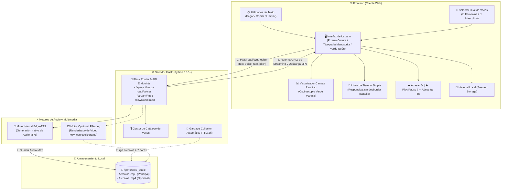
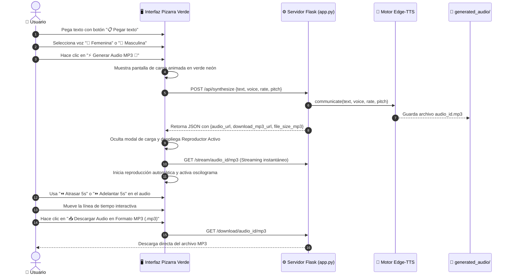
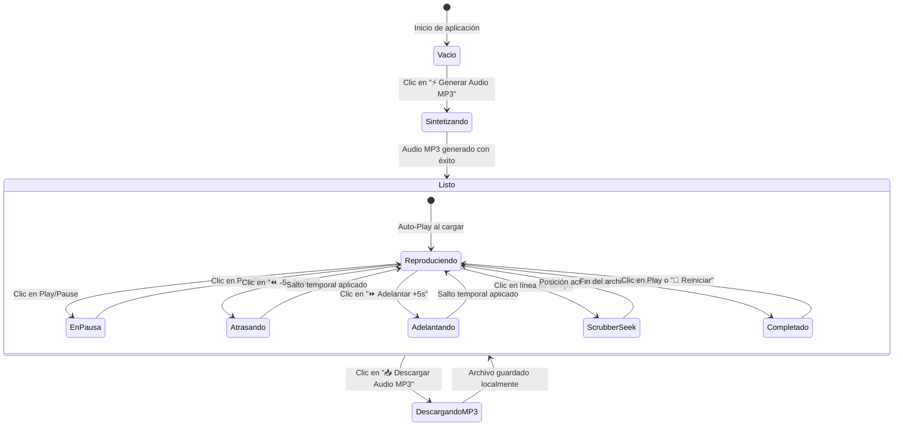

# 🎙️ VozVerde TTS | Sintetizador de Texto a Voz Neural en Formato MP3 🎵

> **Aplicación web de Texto a Voz (Text-to-Speech) de alta fidelidad con diseño de pizarra oscura, tipografía estilo manuscrito, acentos en verde neón, selector de voz femenina y masculina, controles para adelantar y atrasar, y descarga directa en formato MP3.**

[](https://www.python.org/)
[](https://flask.palletsprojects.com/)
[](https://github.com/rany2/edge-tts)
[](#descargas)
[](#licencia)

---

## 🌟 Características Principales

- **📋 Entrada de Texto Rápida y Sencilla**:
  - Botón **📋 Pegar texto** directo desde el portapapeles con un solo clic.
  - Botón **📄 Copiar texto** y **🧹 Limpiar**.
  - Plantillas de texto rápido con emojis (🎙️ *Intro Podcast*, 📖 *Cuento Mágico*, 📢 *Anuncio*, 🗣️ *Trabalenguas*, ✨ *Inspiración*).
  - Contador de caracteres en tiempo real (hasta 10,000) y de palabras.

- **👩 👨 Selección Clara de Voz (Femenina o Masculina)**:
  - Selector dual directo con tarjetas interactivas de **Voz Femenina 👩** y **Voz Masculina 👨**.
  - **Voces Femeninas**: Dalia (🇲🇽 México), Elvira (🇪🇸 España), Salomé (🇨🇴 Colombia), Elena (🇦🇷 Argentina), Catalina (🇨🇱 Chile), Paloma (🇺🇸 EE.UU.), Jenny (🇺🇸 Inglés).
  - **Voces Masculinas**: Jorge (🇲🇽 México), Álvaro (🇪🇸 España), Gonzalo (🇨🇴 Colombia), Tomás (🇦🇷 Argentina), Lorenzo (🇨🇱 Chile), Guy (🇺🇸 EE.UU.).
  - Filtro por país/acento y afinador de **velocidad de habla** (-50% a +50%) y **tono** (-30Hz a +30Hz).

- **🎧 Reproductor Integrado con Visualizador Osciloscópico**:
  - **Visualizador Canvas Reactivo**: Ondas osciloscópicas verde neón (`#00ff66`) que bailan sincronizadas con las frecuencias del audio en tiempo real.
  - **Ficha del Audio en Reproducción**: Muestra el estado en vivo (🟢 *Reproduciendo* / ⏸️ *En Pausa*), la voz y género activo, y el texto narrado.
  - **Controles de Audio**:
    - ⏪ **Atrasar 5 segundos** (`-5s`).
    - ▶️ **Reproducir** / ⏸️ **Pausar**.
    - ⏩ **Adelantar 5 segundos** (`+5s`).
    - 🔄 **Reiniciar** desde el inicio.
    - 🔊 Control deslizable de volumen con icono dinámico.
    - ⚡ Selector de velocidad de reproducción (0.8x, 1.0x, 1.25x, 1.5x).

- **📏 Línea de Tiempo Simple y Responsiva (Anti-Desbordamiento)**:
  - Diseñada con Flexbox y límites elásticos (`box-sizing: border-box`, `min-width: 0`, `overflow: hidden`).
  - **Garantizado**: La línea de tiempo no desborda la longitud de la pantalla en ningún dispositivo móvil, tablet o pantalla de escritorio.
  - Barra de progreso interactiva con desplazamiento suave y tiempo actual vs. duración total (`MM:SS`).

- **💾 Descarga Directa en Formato de Audio MP3**:
  - **Descarga Principal MP3 (.mp3)**: Botón destacado en verde neón para guardar tu audio en formato MP3 estándar universal compatible con cualquier reproductor, smartphone o editor multimedia.
  - **Opciones Complementarias**: Generación bajo demanda de video MP4 con oscilograma visualizador para redes sociales y audio en contenedor MP4 (AAC).

- **🎨 Estética Visual Única**:
  - **Pizarra Oscura / Libreta Digital**: Fondo negro profundo (`#050805`, `#020402`) con sutiles halos de resplandor verde.
  - **Tipografía Manuscrita**: Fuentes Google Fonts (*Caveat*, *Patrick Hand* y *Kalam*) que simulan escritura a mano con tiza sobre pizarra.
  - **Acentos Verde Neón (`#00ff66`, `#10b981`)**: Botones con resplandor luminoso, deslizadores e interfaces intuitivas repletas de emojis.

- **📜 Historial de Sesión**:
  - Guarda los audios generados durante tu sesión para volver a escucharlos o descargarlos en MP3 en cualquier momento.

---

## 📐 Diagramas de Arquitectura (Mermaid)

### 1. Diagrama General del Sistema



---

### 2. Flujo de Síntesis y Descarga MP3 (Diagrama de Secuencia)



---

### 3. Máquina de Estados del Reproductor de Audio



---

## 🚀 Requisitos del Sistema

- **Python**: Versión 3.10 o superior.
- **Conexión a Internet**: Necesaria para la síntesis de voces neurales de Edge-TTS.
- **Navegador Web Moderno**: Chrome, Edge, Firefox, Safari u Opera con soporte para HTML5 Audio y Canvas 2D.
- **FFmpeg (Opcional)**: Únicamente necesario si deseas generar videos MP4 animados con oscilograma. El audio MP3 funciona de forma nativa e inmediata sin requerir FFmpeg.

---

## 🛠️ Instalación y Puesta en Marcha

### Método 1: Ejecución Rápida en Windows (Recomendado)

Haz doble clic en cualquiera de los scripts incluidos en el proyecto:

- **`run.bat`**: Script clásico de consola por lotes.
- **`run.ps1`**: Script moderno de PowerShell (abre el navegador automáticamente).

Ambos scripts verificarán las dependencias automáticamente y levantarán el servidor.

---

### Método 2: Instalación Manual por Terminal

1. **Clonar o abrir la carpeta del proyecto**:
   ```bash
   cd c:\Users\fer87\Documents\MisProyectos\Antigravity
   ```

2. **Crear y activar un entorno virtual (recomendado)**:
   ```bash
   # En Windows
   python -m venv venv
   .\venv\Scripts\activate

   # En Linux / macOS
   python3 -m venv venv
   source venv/bin/activate
   ```

3. **Instalar dependencias**:
   ```bash
   pip install -r requirements.txt
   ```

4. **Iniciar la aplicación**:
   ```bash
   python app.py
   ```

5. **Abrir en tu navegador**:
   Abre [http://localhost:5000](http://localhost:5000) o [http://127.0.0.1:5000](http://127.0.0.1:5000).

---

## 📖 Guía de Uso Rápida

1. **Pegar o Escribir Texto**:
   - Pulsa el botón **📋 Pegar texto** para insertar el contenido que tengas copiado, o escribe directamente en el área con estilo de libreta.
   - También puedes hacer clic en cualquiera de los ejemplos sugeridos (como *Intro Podcast* o *Cuento Mágico*).

2. **Elegir la Voz (Femenina o Masculina)**:
   - Haz clic en la tarjeta **👩 Voz Femenina** o **👨 Voz Masculina**.
   - Opcionalmente puedes seleccionar tu país o acento favorito en el desplegable (México 🇲🇽, España 🇪🇸, Colombia 🇨🇴, Argentina 🇦🇷, Chile 🇨🇱, EE. UU. 🇺🇸).

3. **Ajustar Velocidad y Tono (Opcional)**:
   - Si deseas un audio más pausado o dinámico, modula la velocidad (-50% a +50%) y el tono de voz (-30Hz a +30Hz).

4. **Generar el Audio**:
   - Presiona el botón verde neón **⚡ Generar Audio MP3 🎵**.

5. **Escuchar y Controlar el Audio**:
   - El audio comenzará a sonar automáticamente.
   - Observa las ondas verdes reactivas en el visualizador.
   - Usa **⏪ Atrasar 5s** o **⏩ Adelantar 5s** para revisar partes específicas del audio.
   - Desplázate por la **línea de tiempo** sin preocuparte por desbordamientos de pantalla.

6. **Descargar tu Archivo MP3**:
   - Pulsa el botón principal **📥 Descargar Audio en Formato MP3 (.mp3)** para guardar tu archivo inmediatamente en tu computadora o teléfono.

---

## 📡 Referencia de la API REST

### `POST /api/synthesize`
Sintetiza un texto y genera el archivo MP3.

- **Payload JSON**:
  ```json
  {
    "text": "¡Hola mundo! Este es mi primer audio en MP3.",
    "voice": "es-MX-DaliaNeural",
    "rate": "+0%",
    "pitch": "+0Hz",
    "create_video": false
  }
  ```

- **Respuesta JSON exitosa (200 OK)**:
  ```json
  {
    "success": true,
    "id": "a1b2c3d4e5f6",
    "format": "mp3",
    "filename_mp3": "vozverde_a1b2c3d4e5f6.mp3",
    "audio_url": "/stream/a1b2c3d4e5f6/mp3",
    "download_mp3_url": "/download/a1b2c3d4e5f6/mp3",
    "file_size_mp3": "142.5 KB",
    "voice": "es-MX-DaliaNeural",
    "voice_name": "Dalia",
    "voice_gender": "Mujer",
    "voice_flag": "🇲🇽",
    "text_preview": "¡Hola mundo! Este es mi primer audio en MP3."
  }
  ```

### `GET /api/voices`
Retorna el catálogo completo de voces curadas y clasificadas por género (Femenina y Masculina) y por país.

### `GET /stream/<file_id>/mp3`
Transmite el archivo MP3 para reproducción y buffering en el navegador (`audio/mpeg`).

### `GET /download/<file_id>/mp3`
Descarga directa del archivo MP3 adjunto (`attachment`) con nombre descriptivo.

---

## 📁 Estructura del Proyecto

```text
Antigravity/
├── app.py                     # Servidor Flask principal y lógica de síntesis
├── requirements.txt           # Dependencias Python (Flask, edge-tts, etc.)
├── run.bat                    # Script de inicio rápido en Windows (Batch)
├── run.ps1                    # Script de inicio rápido en Windows (PowerShell)
├── README.md                  # Documentación principal con diagramas Mermaid
├── docs/                      # Documentación técnica extendida
│   ├── ARQUITECTURA.md        # Especificación técnica detallada y diagramas
│   ├── GUIA_DE_USO.md         # Manual paso a paso para el usuario
│   └── API_DOCS.md            # Especificación completa de la API REST
├── templates/
│   └── index.html             # Interfaz web con estilo pizarra oscura y neón verde
├── static/
│   ├── css/
│   │   └── style.css          # Estilos CSS, tipografía manuscrita y controles
│   └── js/
│       ├── app.js             # Lógica frontend, reproductor, pegar texto e historial
│       └── visualizer.js      # Visualizador osciloscópico Canvas en tiempo real
└── generated_audio/           # Carpeta de almacenamiento temporal (auto-limpieza)
```

---

## 📄 Licencia

Este proyecto está bajo la Licencia **MIT**. Eres libre de usarlo, modificarlo y distribuirlo para fines personales o comerciales.
