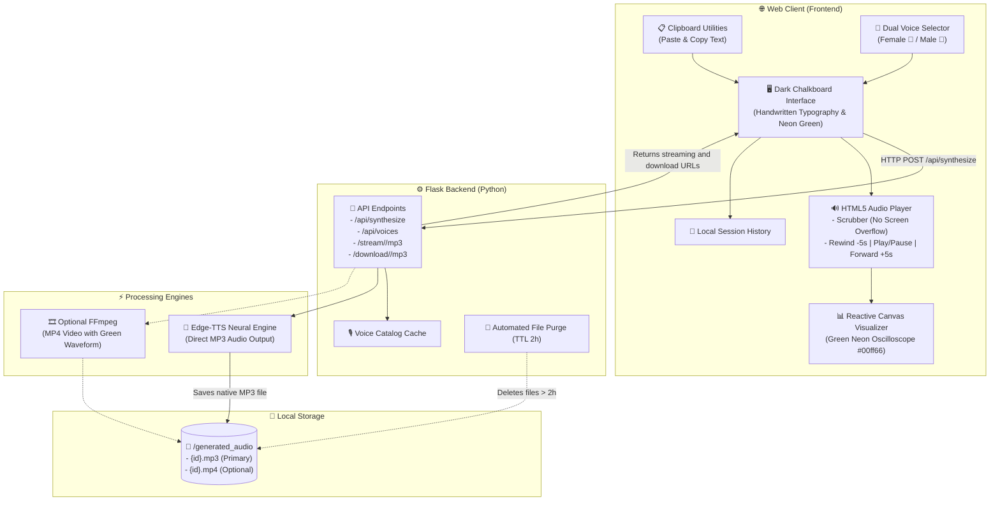

# 🏛️ Technical Architecture of VozVerde TTS (MP3 Format)

This document describes the software architecture, design patterns, components, and audio processing pipeline for **VozVerde TTS**.

---

## 1. System Overview

VozVerde TTS is built with a decoupled client-server architecture:
1. **Lightweight Responsive Frontend**: Native HTML5, CSS3, and modern Vanilla JavaScript with Google Fonts (`Caveat`, `Patrick Hand`, `Kalam`). Features an oscilloscope-style Canvas visualizer in fluorescent green (`#00ff66`), forward/rewind controls (±5s), and a clean progress timeline designed to never overflow screen width.
2. **Flask Backend**: Exposes a minimal REST API for text-to-speech synthesis, streaming (`audio/mpeg`), and attachment downloads.
3. **Edge-TTS Neural Engine**: Generates high-fidelity MP3 audio directly via secure WebSockets with Microsoft Edge speech services.

---

## 2. Architecture Diagram (Mermaid)

---

## 3. Key Design Decisions

1. **Direct MP3 Synthesis**: Edge-TTS natively creates `.mp3` files, eliminating the overhead of transcode pipelines and guaranteeing 100% universal compatibility across all modern and legacy devices.
2. **Anti-Overflow Scrubber**: Progress container uses `min-width: 0`, `flex: 1 1 auto`, and strict `overflow: hidden` bounding boxes so the timeline never spills out of viewport bounds on mobile devices.
3. **Gender Voice Pairing**: Immediate switching between female and male neural voices (such as Dalia and Jorge for Mexico, Elvira and Álvaro for Spain, etc.).
