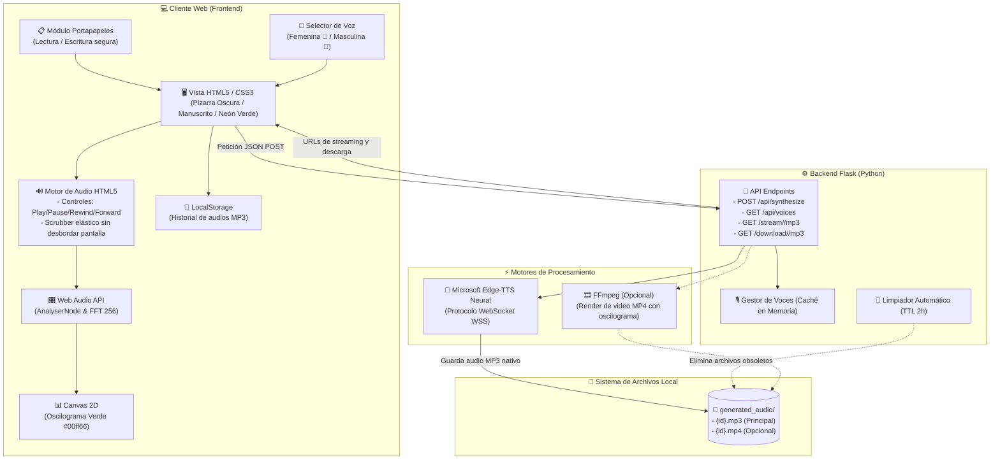
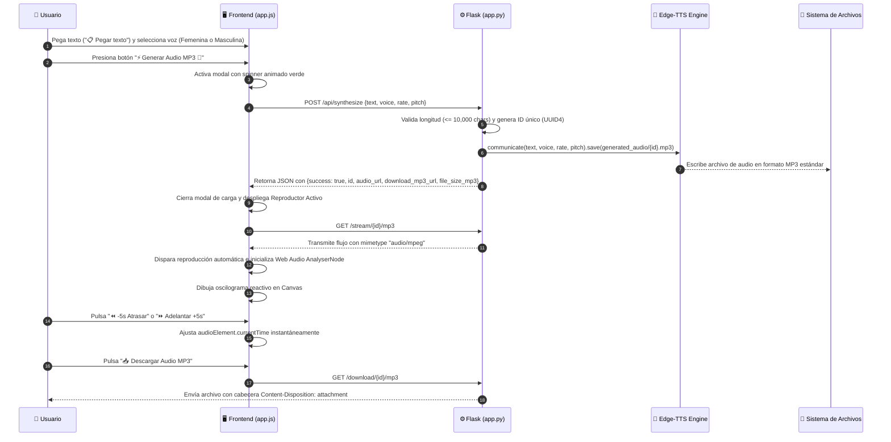

# 🏛️ Arquitectura Técnica de VozVerde TTS (Formato MP3)

Este documento detalla la arquitectura de software, patrones de diseño, componentes técnicos y el pipeline de procesamiento de audio para la aplicación **VozVerde TTS**.

---

## 1. Visión General de la Arquitectura

VozVerde TTS utiliza una arquitectura orientada a servicios desacoplados:
1. **Frontend Reactivo Nativo**:
   - Construido con HTML5 semántico, CSS3 moderno y JavaScript Vanilla modular.
   - Sin sobrecarga de frameworks pesados (React/Angular/Vue), lo que garantiza tiempos de carga instantáneos y renderizado a 60 FPS en el visualizador Canvas.
   - Manipulación de audio mediante la **Web Audio API** y el elemento HTML5 `<audio>`.
   - Diseño responsivo a prueba de fallos: la línea de tiempo y los controles están contenidos estrictamente para evitar cualquier desbordamiento horizontal en pantallas pequeñas.
2. **Backend en Python (Flask)**:
   - Provee una API REST JSON minimalista y rápida.
   - Orquesta la comunicación con el motor neural **Edge-TTS** mediante WebSockets seguros (WSS).
   - Administra el almacenamiento temporal con un recolector de basura (*garbage collector*) por tiempo de vida (TTL).
   - Ofrece endpoints optimizados para streaming de audio (`audio/mpeg`) con soporte de buffering y descarga directa como archivo adjunto (`Content-Disposition: attachment`).
3. **Pipeline de Síntesis Neural (Edge-TTS)**:
   - Conversión de texto en audio directamente en formato MP3 con codificación a 48kHz y alta tasa de muestreo.

---

## 2. Diagrama de Bloques del Sistema (Mermaid)



---

## 3. Pipeline de Generación y Streaming de Audio MP3



---

## 4. Decisiones de Diseño Técnico

### 4.1 Prioridad Absoluta del Formato MP3
- **Por qué MP3**: Es el formato estándar de audio comprimido con mayor interoperabilidad en la historia de la informática. Es compatible al 100% con todos los sistemas operativos (Windows, macOS, Linux, Android, iOS), navegadores, reproductores de coche, dispositivos portátiles y plataformas web sin requerir transcodificación adicional.
- **Eficiencia**: Edge-TTS produce de forma nativa flujos de audio MP3 de alta fidelidad, evitando la sobrecarga de CPU y consumo de memoria que implicaría recodificar cada audio con librerías externas.

### 4.2 Control Estricto Anti-Desbordamiento de la Línea de Tiempo
Uno de los problemas más comunes en reproductores web es el desbordamiento de la barra de progreso en resoluciones pequeñas o pantallas móviles. En VozVerde TTS se implementaron reglas CSS estrictas:
```css
.timeline-wrapper {
    width: 100%;
    max-width: 100%;
    box-sizing: border-box;
    overflow: hidden;
}

.progress-container {
    display: flex;
    align-items: center;
    gap: 10px;
    width: 100%;
    max-width: 100%;
    box-sizing: border-box;
    min-width: 0; /* Previene la propagación de ancho fijo en Flexbox */
}

.progress-bar-bg {
    flex: 1 1 auto;
    min-width: 0;
    height: 9px;
    /* ... */
}
```

### 4.3 Selector Dual de Voces (Femenina y Masculina)
- La interfaz implementa un selector dual en forma de tarjetas hero (`.gender-card` para Mujer y Hombre).
- Al pulsar una de las tarjetas, se actualiza la voz activa de forma inmediata y se filtra la cuadrícula de locutores disponibles.
- Voces Femeninas principales: **Dalia** (México 🇲🇽), **Elvira** (España 🇪🇸), **Salomé** (Colombia 🇨🇴).
- Voces Masculinas principales: **Jorge** (México 🇲🇽), **Álvaro** (España 🇪🇸), **Gonzalo** (Colombia 🇨🇴).

### 4.4 Visualizador Osciloscópico Canvas
- La clase `AudioWaveformVisualizer` en `visualizer.js` utiliza la **Web Audio API** (`AudioContext`, `AnalyserNode` con `fftSize = 256`).
- Si las restricciones de seguridad del navegador impiden el análisis directo de la fuente de audio, el sistema entra en modo de simulación reactiva fluida (*Synthetic Wave*) para asegurar que el usuario siempre disfrute de la animación en verde neón.

---

## 5. Gestión del Ciclo de Vida de los Archivos

Para evitar que el disco duro se llene con audios generados por múltiples usuarios, `app.py` ejecuta una rutina de limpieza automática en cada invocación:
- **Directorio monitoreado**: `generated_audio/`
- **Tiempo de vida máximo (TTL)**: 7,200 segundos (2 horas).
- Los archivos con antigüedad mayor a 2 horas son purgados silenciosamente mediante `pathlib.Path.unlink()`.
